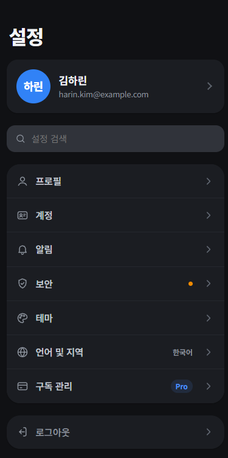
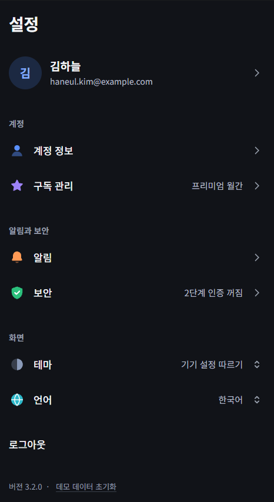

<div align="center">

# 🎨 Toss Tech Design 참고 스킬 v2

**toss.tech 디자인 아티클 143편에서 뽑은 판단 기준을, 출처와 함께 AI 코딩 에이전트에게**

[](SKILL.md)
[](references/sources.md)
[](references/)
[](LICENSE)


[설치](#설치) · [이럴 때 씁니다](#이럴-때-씁니다) · [버전 비교](#버전-비교) · [꿀팁](#꿀팁) · [구성](#구성) · [주의](#주의)

</div>

> [!NOTE]
> 비공식 스킬입니다. Toss(비바리퍼블리카)와 제휴하거나 승인받은 관계가 없습니다.

## 소개

디자인 원칙, UX 라이팅, 퍼널, 접근성, 리서치, 시각 스타일까지. toss.tech 아티클 본문에 나온 판단 기준만 골라 정리했습니다. 모든 규칙에는 근거가 된 글의 제목과 URL이 붙어 있어서, 에이전트가 "왜 이렇게 만들었는지"를 출처로 설명합니다.

## 설치

```bash
npx skills add Ilbie/Toss-Design-Skill
```

설치하면 끝입니다. 요청이 스킬과 맞으면 에이전트가 알아서 불러옵니다.

## 이럴 때 씁니다

| 상황 | 예시 요청 |
| --- | --- |
| 화면·UI 만들기 | "설정 화면 만들어줘" |
| 화면·플로우 설계와 리뷰 | "이 가입 플로우 리뷰해줘" |
| UX 문구·에러 메시지·푸시 | "결제 실패 에러 문구 다듬어줘" |
| 접근성·다크패턴 점검 | "이 해지 화면 다크패턴 아니야?" |
| 리서치·A/B 테스트·기능 판단 | "이 기능 넣을지 뺄지 정리해줘" |

## 버전 비교

같은 "설정 화면" 요청을 스킬 버전별로 만든 결과입니다.

<table>
  <tr>
    <th align="center">v1.3</th>
    <th align="center">v2</th>
  </tr>
  <tr>
    <td align="center"></td>
    <td align="center"></td>
  </tr>
</table>

<p align="center"><sub>두 스크린샷 모두 <b>Claude Opus 5.5 (effort: medium)</b> 로 생성</sub></p>

## 꿀팁

> [!TIP]
> 여러 모델로 돌려 봤을 때 **Anthropic 계열 모델(Claude)** 이 이 스킬을 가장 잘 활용하는 것 같습니다.

## 구성

```
Toss-Design-Skill/
├── SKILL.md        # 핵심 원칙과 상황별로 읽을 파일 안내
├── references/     # 주제별 정리 21개 + 출처 목록(sources.md)
└── images/         # README용 버전 비교 스크린샷
```

<details>
<summary><b>references/ 전체 목록 펼치기</b></summary>

| 분류 | 파일 |
| --- | --- |
| 원칙과 판단 | `principles.md` · `decision-making.md` · `ethics.md` |
| 문제 해결 | `problem-solving.md` · `problem-solving-cases.md` |
| UX 라이팅 | `ux-writing.md` · `ux-writing-errors-marketing.md` |
| 흐름과 구조 | `funnels-and-flows.md` · `domain-flows-and-ia.md` |
| 시각과 인터랙션 | `visual-style.md` · `interaction.md` · `graphics-branding.md` |
| 접근성 | `accessibility-inclusion.md` |
| 리서치와 데이터 | `research-methods.md` · `research-ops.md` · `data-and-experiments.md` |
| 팀과 시스템 | `design-systems-and-standards.md` · `working-with-teams.md` · `team-roles-and-growth.md` · `internal-tools-b2b.md` |
| AI | `ai-practices.md` |
| 출처 | `sources.md` |

</details>

## 주의

> [!WARNING]
> - 사고방식과 원칙을 참고하기 위한 자료입니다. Toss 화면을 그대로 따라 만드는 용도가 아닙니다.
> - Toss 명칭, 로고, 토스페이스·Toss Product Sans 같은 전용 자산은 결과물에 쓰지 마세요.

내용이 문제가 된다면 GitHub Issue나 메일로 알려 주세요. 확인 후 바로 수정하거나 삭제하겠습니다.

## 라이선스

[MIT](LICENSE) 라이선스는 이 저장소에서 직접 쓴 문서에만 적용됩니다. toss.tech 원문과 이미지, 상표의 권리는 각 권리자에게 있습니다.
